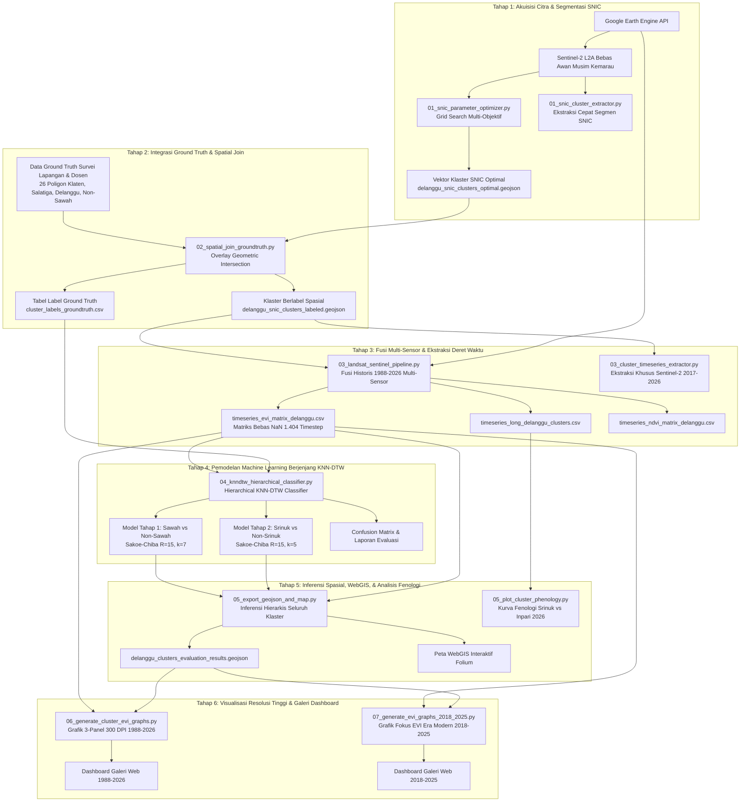

# PANDUAN KOMPREHENSIF CARA KERJA SISTEM KODE PROGRAM TUGAS AKHIR
**Analisis Pola Pertumbuhan Padi Varietas Rojolele Srinuk Menggunakan Data Satelit Time Series Berbasis Multi-Sensor dan KNN-DTW**  
*Studi Kasus:* Kecamatan Delanggu & Tulung, Kabupaten Klaten, Jawa Tengah  
*Peneliti:* Muhammad Hakim Ghifari Akiyat (NPM: 6182201096)  
*Program Studi:* Informatika, Fakultas Teknologi Informasi dan Sains (FTIS), Universitas Katolik Parahyangan (UNPAR)  
*Rujukan Metodologi:* Kerangka Kerja Ilmiah Skripsi Vico Pratama (2025)

---

## DAFTAR ISI
1. [Ikhtisar Arsitektur Sistem & Alur Kerja Pipeline](#1-ikhtisar-arsitektur-sistem--alur-kerja-pipeline)
2. [Modul 01: Segmentasi Superpixel SNIC & Optimasi Parameter](#2-modul-01-segmentasi-superpixel-snic--optimasi-parameter)
   - [01_snic_cluster_extractor.py](#01_snic_cluster_extractorpy)
   - [01_snic_parameter_optimizer.py](#01_snic_parameter_optimizerpy)
3. [Modul 02: Penyatuan Ground Truth & Spatial Join Pelabelan Klaster](#3-modul-02-penyatuan-ground-truth--spatial-join-pelabelan-klaster)
   - [02_spatial_join_groundtruth.py](#02_spatial_join_groundtruthpy)
   - [02_spatial_join_labeler.py](#02_spatial_join_labelerpy)
4. [Modul 03: Ekstraksi Deret Waktu & Fusi Citra Multi-Sensor (1988–2026)](#4-modul-03-ekstraksi-deret-waktu--fusi-citra-multi-sensor-19882026)
   - [03_cluster_timeseries_extractor.py](#03_cluster_timeseries_extractorpy)
   - [03_landsat_sentinel_pipeline.py](#03_landsat_sentinel_pipelinepy)
5. [Modul 04: Visualisasi Spasial & Klasifikasi Berjenjang KNN-DTW](#5-modul-04-visualisasi-spasial--klasifikasi-berjenjang-knn-dtw)
   - [04_cluster_map_visualizer.py](#04_cluster_map_visualizerpy)
   - [04_knndtw_hierarchical_classifier.py](#04_knndtw_hierarchical_classifierpy)
6. [Modul 05: Inferensi Spasial, Peta Klasifikasi, & Plot Fenologi](#6-modul-05-inferensi-spasial-peta-klasifikasi--plot-fenologi)
   - [05_export_geojson_and_map.py](#05_export_geojson_and_mappy)
   - [05_plot_cluster_phenology.py](#05_plot_cluster_phenologypy)
7. [Modul 06: Generator Grafik Deret Waktu Individual Per Klaster (1988–2026)](#7-modul-06-generator-grafik-deret-waktu-individual-per-klaster-19882026)
   - [06_generate_cluster_evi_graphs.py](#06_generate_cluster_evi_graphspy)
8. [Modul 07: Visualisasi Fokus EVI Era Modern Sentinel-2 (2018–2025)](#8-modul-07-visualisasi-fokus-evi-era-modern-sentinel-2-20182025)
   - [07_generate_evi_graphs_2018_2025.py](#07_generate_evi_graphs_2018_2025py)
9. [Skrip Google Earth Engine JavaScript (B.1 – B.3)](#9-skrip-google-earth-engine-javascript-b1--b3)
   - [B1_delanggu_snic_gee_editor.js](#b1_delanggu_snic_gee_editorjs)
   - [B2_snic_parameter_tuning.js](#b2_snic_parameter_tuningjs)
   - [B3_delanggu_landsat_sentinel_pipeline.js](#b3_delanggu_landsat_sentinel_pipelinejs)
10. [Matriks Ringkasan & Keterkaitan Antar-Berkas](#10-matriks-ringkasan--keterkaitan-antar-berkas)
11. [Panduan Urutan Eksekusi Program (Step-by-Step Execution)](#11-panduan-urutan-eksekusi-program-step-by-step-execution)

---

## 1. Ikhtisar Arsitektur Sistem & Alur Kerja Pipeline

Sistem perangkat lunak ini dirancang untuk mengatasi permasalahan klasifikasi varietas padi unggul lokal (*Rojolele Srinuk*) dari varietas pembanding (*Inpari 32, Membramo, Mapan*) serta lahan non-sawah di kawasan sentra Delanggu, Klaten. 

Secara konseptual, sistem ini menerapkan pendekatan **OBIA (Object-Based Image Analysis)** berbasis **SNIC (Simple Non-Iterative Clustering)** untuk mengelompokkan piksel menjadi segmen petak sawah homogen, menggabungkan data deret waktu multi-sensor 38 tahun (**Landsat 5 TM, 7 ETM+, 8 OLI, 9 OLI-2, dan Sentinel-2 MSI**), dan melakukan klasifikasi hierarkis dua tahap menggunakan **KNN-DTW (K-Nearest Neighbors with Dynamic Time Warping)** berkendala Sakoe-Chiba.



---

## 2. Modul 01: Segmentasi Superpixel SNIC & Optimasi Parameter

Modul 01 bertanggung jawab mengonversi citra penginderaan jauh berbasis piksel menjadi **objek spasial homogen (superpixel)** yang merepresentasikan petak-petak sawah nyata di lapangan.

### `01_snic_cluster_extractor.py`
[01_snic_cluster_extractor.py](file:///c:/Users/Lenovo/OneDrive%20-%20Universitas%20Katolik%20Parahyangan/Drive%20Kuliah/TUGAS%20AKHIR/PROGRAM/src/01_snic_cluster_extractor.py)

#### A. Tujuan & Peran
Skrip ekstraksi cepat untuk menghasilkan poligon klaster superpixel SNIC langsung di wilayah Delanggu dengan parameter *baseline* skripsi Vico Pratama (`size=9`, `compactness=10`, `connectivity=8`).

#### B. Cara Kerja Algoritma Baris-per-Baris:
1. **Inisialisasi GEE & Pemuatan ROI:**
   - Membaca file GeoJSON ground truth survei `data/raw/delanggu_geojson_tuned.geojson`.
   - Mengambil bounding box ROI dengan buffer ekspansi 500 meter (`fc_gt.geometry().buffer(500).bounds()`) agar mencakup area persawahan penyangga di sekitar petak survei.
2. **Pra-pemrosesan Citra Sentinel-2 L2A Harmonized:**
   - Menyaring koleksi `COPERNICUS/S2_SR_HARMONIZED` yang bertautan (*linked*) dengan `GOOGLE/CLOUD_SCORE_PLUS/V1/S2_HARMONIZED`.
   - Melakukan *cloud masking* ketat dengan ambang batas `cs >= 0.60` (Cloud Score+).
   - Menghitung **Enhanced Vegetation Index (EVI)** dan **Normalized Difference Vegetation Index (NDVI)** dari Surface Reflectance ($DN / 10000.0$):
     $$\text{EVI} = 2.5 \times \frac{\text{NIR} - \text{Red}}{\text{NIR} + 6.0 \times \text{Red} - 7.5 \times \text{Blue} + 1.0}$$
     $$\text{NDVI} = \frac{\text{NIR} - \text{Red}}{\text{NIR} + \text{Red}}$$
3. **Pemberian Proyeksi Eksplisit Metrik UTM Zone 49S:**
   - Menghitung rata-rata citra temporal EVI (`avg_evi`) dan mematok proyeksi `setDefaultProjection(crs='EPSG:32749', scale=10)`. Ini mencegah GEE mereset sistem koordinat ke derajat lintang/bujur WGS84 (`EPSG:4326`) yang dapat merusak penghitungan jarak *seed* superpixel.
4. **Eksekusi Segmentasi SNIC:**
   - Memanggil fungsi server GEE: `ee.Algorithms.Image.Segmentation.SNIC(image=avg_evi, size=9, compactness=10, connectivity=8, neighborhoodSize=18)`.
   - Algoritma meletakkan benih (*seeds*) berjarak 9 piksel ($\approx 90\text{ m}$), lalu mengembangkan klaster ke 8 arah piksel tetangga dengan mempertimbangkan jarak warna spektral EVI dan jarak spasial.
5. **Vektorisasi Raster Menjadi Poligon:**
   - Menggunakan `reduceToVectors(geometryType='polygon', scale=10, eightConnected=True, labelProperty='cluster_id')`.
   - Mengonversi FeatureCollection GEE ke GeoDataFrame lokal melalui `geemap.ee_to_gdf()`.
   - Menghitung luas poligon metrik dalam $\text{m}^2$ dan hektare ($\text{ha} = \text{m}^2 / 10000$), kemudian menyimpannya ke `data/spatial/delanggu_snic_clusters.geojson`.

---

### `01_snic_parameter_optimizer.py`
[01_snic_parameter_optimizer.py](file:///c:/Users/Lenovo/OneDrive%20-%20Universitas%20Katolik%20Parahyangan/Drive%20Kuliah/TUGAS%20AKHIR/PROGRAM/src/01_snic_parameter_optimizer.py)

#### A. Tujuan & Peran
Melakukan evaluasi parameter multi-objektif (*grid search*) untuk menemukan kombinasi `size` dan `compactness` yang paling ideal secara matematis untuk lanskap sawah di Delanggu, mengadopsi formulasi kuantitatif Vico Pratama (2025, hal. 141).

#### B. Formulasi Matematis Multi-Objektif:
Tujuan segmentasi adalah menemukan titik keseimbangan antara **homogenitas spektral internal** (variansi sekecil mungkin) dan **efisiensi representasi objek** (jumlah klaster seminimal mungkin agar tidak terjadi *over-segmentation*):

1. **Variansi EVI Intra-Klaster:**
   $$\text{Var}_c = \frac{1}{|C|} \sum_{p \in C} (\text{EVI}_p - \mu_C)^2 \implies \overline{\text{Var}} = \frac{1}{K} \sum_{c=1}^K \text{Var}_c$$
2. **Normalisasi Min-Max:**
   $$\overline{\text{Var}}_{\text{norm}} = \frac{\overline{\text{Var}} - \overline{\text{Var}}_{\min}}{\overline{\text{Var}}_{\max} - \overline{\text{Var}}_{\min}}, \quad K_{\text{norm}} = \frac{K - K_{\min}}{K_{\max} - K_{\min}}$$
3. **Fungsi Biaya Multi-Objektif (Score):**
   $$\text{Score} = \varpi \cdot \overline{\text{Var}}_{\text{norm}} + (1 - \varpi) \cdot K_{\text{norm}}, \quad \text{dengan } \varpi = 0.3$$
   *Kombinasi parameter dengan nilai Score terkecil merupakan parameter terbaik.*

#### C. Cara Kerja Kode:
1. **Pemilihan Citra Optimal:** Mengambil citra tunggal Sentinel-2 terbersih musim kemarau di Delanggu tanggal **2020-08-21** (tutupan awan hanya 0.11%).
2. **Iterasi Grid Search:** Menguji ruang parameter:
   - $\text{Size} \in [4, 5, 6, 7, 8, 9, 10]$
   - $\text{Compactness} \in [1, 5, 10, 25, 50, 100]$ (Total 42 kombinasi).
3. **Reduksi Spasial Cepat di Server GEE:**
   - Untuk setiap kombinasi, GEE menghitung vektor klaster dan mengekstrak variansi EVI intra-klaster menggunakan `reduceRegions(reducer=ee.Reducer.variance())`.
   - Mengambil metrik `variance_mean` dan `cluster_count` dalam **satu panggilan jaringan GEE** (`metrics.getInfo()`) untuk memaksimalkan efisiensi komputasi.
4. **Peringkat & Ekspor:**
   - Menyimpan seluruh 42 iterasi ke `outputs/snic_tuning_results_delanggu.csv`.
   - Mengekstrak poligon klaster dengan parameter terbaik ke file `data/spatial/delanggu_snic_clusters_optimal.geojson`.

---

## 3. Modul 02: Penyatuan Ground Truth & Spatial Join Pelabelan Klaster

Sebelum model dapat dilatih, klaster superpixel tanpa nama harus dipasangkan dengan label varietas tanaman nyata yang diperoleh dari survei lapang.

### `02_spatial_join_groundtruth.py`
[02_spatial_join_groundtruth.py](file:///c:/Users/Lenovo/OneDrive%20-%20Universitas%20Katolik%20Parahyangan/Drive%20Kuliah/TUGAS%20AKHIR/PROGRAM/src/02_spatial_join_groundtruth.py)

#### A. Tujuan & Peran
Menyatukan seluruh arsip berkas ground truth spasial (berasal dari data dosen pembimbing, survei lapangan mandiri Delanggu, dan poligon non-sawah) ke dalam satu GeoJSON standar terintegrasi, lalu memetakan label varietas tersebut ke klaster superpixel SNIC melalui analisis tumpang tindih spasial (*overlay spatial join*).

#### B. Cara Kerja Algoritma:
1. **Standardisasi Data Multi-Sumber (`load_and_standardize_ground_truth`):**
   - Membaca 13 file GeoJSON ground truth survei Klaten (`data/raw/Data Dikasih/Klaten/`). File ini dikelompokkan berdasarkan nama file menjadi varietas `Rojolele Srinuk`, `Membramo`, `Mapan`, atau `Inpari 32`, serta fase usia (1 minggu, 1 bulan, 1.5 bulan, 2 bulan, 2.5 bulan, 3 bulan).
   - Membaca 7 file GeoJSON varietas pembanding Inpari 32 di Tingkir, Salatiga (`data/raw/Data Dikasih/Salatiga/`).
   - Membaca poligon ground truth Delanggu yang telah terkalibrasi (`delanggu_geojson_tuned.geojson`).
   - Membaca poligon area non-sawah (`data/non_sawah.geojson`) yang mencakup pemukiman penduduk, bangunan pabrik, dan jalan raya.
   - Menggabungkan seluruh poligon menjadi satu kesatuan: `data/processed/unified_ground_truth_all.geojson` (total 26 entitas poligon acuan).
2. **Proyeksi Metrik & Pemisahan MultiPolygon:**
   - Mengubah CRS kedua dataset ke sistem proyeksi meter **UTM Zone 49S (`EPSG:32749`)**.
   - Menjalankan `.explode(index_parts=False)` pada ground truth agar poligon majemuk terpecah menjadi poligon tunggal mandiri.
3. **Analisis Irisan Geometris Spasial (Geometric Intersection Overlay):**
   - Melakukan pemotongan spasial poligon: `gpd.overlay(clusters_utm, gt_exploded, how='intersection')`.
   - Menghitung luas area irisan ($\text{overlap\_area}$) untuk setiap pasangan klaster dan petak ground truth.
   - Menghitung rasio tumpang tindih:
     $$\text{Overlap Ratio} = \frac{\text{Area}(\text{Klaster} \cap \text{Ground Truth})}{\text{Area}(\text{Klaster})}$$
4. **Strategi Filtering & Penyeimbangan Sampel (Dataset Balancing):**
   - **Klaster Sawah:** Memilih klaster yang memiliki irisan dengan petak sawah survei ($\text{overlap\_ratio} \ge 0.02$). Jika satu klaster beririsan dengan beberapa varietas, klaster diasosiasikan dengan varietas yang memiliki luas tumpang tindih terbesar (`keep='first'` setelah disortir *descending*). Diperoleh **26 klaster sawah** (Srinuk, Inpari 32, Membramo, Mapan).
   - **Klaster Non-Sawah:** Memilih klaster yang tumpang tindih dengan poligon pemukiman/jalan ($\text{overlap\_ratio} \ge 0.15$). Diambil sampel acak terkontrol sebanyak **26–30 klaster** (`sample(n=30, random_state=42)`).
   - Total dihasilkan **52 klaster berlabel seimbang (balanced 50:50)** antara sawah dan non-sawah, mencegah model mengalami *class-imbalance bias*.
5. **Output Berkas:**
   - Menyimpan seluruh geometri klaster lengkap dengan atribut label ke `data/spatial/delanggu_snic_clusters_labeled.geojson`.
   - Mengekstrak tabel metadata label ke `data/processed/cluster_labels_groundtruth.csv`.

---

### `02_spatial_join_labeler.py`
[02_spatial_join_labeler.py](file:///c:/Users/Lenovo/OneDrive%20-%20Universitas%20Katolik%20Parahyangan/Drive%20Kuliah/TUGAS%20AKHIR/PROGRAM/src/02_spatial_join_labeler.py)

#### A. Tujuan & Peran
Versi spesifik dari modul pelabelan spasial yang difokuskan khusus pada data survei lapang Delanggu (`delanggu_geojson_tuned.geojson`), menerapkan ambang batas seleksi tumpang tindih yang lebih ketat ($\text{min\_overlap} = 0.30$ atau 30%).

#### B. Cara Kerja Kode:
- Membaca klaster `delanggu_snic_clusters.geojson` dan ground truth 5 petak Srinuk serta 2 petak Inpari 32 di Delanggu.
- Melakukan operasi spasial irisan dalam proyeksi UTM Zone 49S.
- Menolak klaster tepi pematang yang hanya menyenggol petak survei di bawah 30% area, sehingga hanya klaster inti sawah yang diberi label `Srinuk` atau `Inpari 32`.
- Menghasilkan file label `data/processed/cluster_labels_delanggu.csv`.

---

## 4. Modul 03: Ekstraksi Deret Waktu & Fusi Citra Multi-Sensor (1988–2026)

Modul ini merupakan mesin penambangan data (*data mining engine*) yang mengekstrak nilai indeks vegetasi temporal untuk setiap klaster dari arsip citra satelit Google Earth Engine.

### `03_cluster_timeseries_extractor.py`
[03_cluster_timeseries_extractor.py](file:///c:/Users/Lenovo/OneDrive%20-%20Universitas%20Katolik%20Parahyangan/Drive%20Kuliah/TUGAS%20AKHIR/PROGRAM/src/03_cluster_timeseries_extractor.py)

#### A. Tujuan & Peran
Mengekstrak deret waktu khusus sensor Sentinel-2 MSI (2017–2026) beresolusi 10 meter untuk klaster-klaster sawah terverifikasi.

#### B. Cara Kerja Kode:
1. Membaca `delanggu_snic_clusters_labeled.geojson` dan memfilter hanya klaster yang memiliki status `is_ground_truth = True`.
2. Menyiapkan koleksi `COPERNICUS/S2_SR_HARMONIZED` dengan masker awan Cloud Score+ (`cs >= 0.60`).
3. Menerapkan `reduceRegions(collection=fc_labeled, reducer=ee.Reducer.mean(), scale=10)` per tanggal citra.
4. Mengekstrak rata-rata EVI dan NDVI, lalu menyusunnya ke dalam:
   - Format panjang (*long table*): `timeseries_long_delanggu_clusters.csv`.
   - Format matriks pivot: `timeseries_evi_matrix_delanggu.csv` dan `timeseries_ndvi_matrix_delanggu.csv`.
   - Data subset musim kemarau 2026: `timeseries_2026_delanggu_clusters.csv`.

---

### `03_landsat_sentinel_pipeline.py`
[03_landsat_sentinel_pipeline.py](file:///c:/Users/Lenovo/OneDrive%20-%20Universitas%20Katolik%20Parahyangan/Drive%20Kuliah/TUGAS%20AKHIR/PROGRAM/src/03_landsat_sentinel_pipeline.py)

#### A. Tujuan & Peran
Mengimplementasikan fusi citra multi-sensor historis 38 tahun (1988 s/d 2026) yang menggabungkan **5 generasi satelit**:
1. **Landsat 5 TM** (1988 – 2012)
2. **Landsat 7 ETM+** (1999 – 2026)
3. **Landsat 8 OLI** (2013 – 2026)
4. **Landsat 9 OLI-2** (2021 – 2026)
5. **Sentinel-2 MSI** (2018 – 2026)

#### B. Cara Kerja Algoritma Harmonisasi Citra:
1. **Standardisasi Masking Awan Per Sensor:**
   - **Sentinel-2:** Cloud Score+ (`cs >= 0.60`).
   - **Landsat 5/7/8/9:** Mengevaluasi bitmask `QA_PIXEL` pada Level-2 Collection 2 Tier 1. Bit 0 s/d 4 (fill, dilated cloud, cirrus, cloud, cloud shadow) harus bernilai 0 (kondisi jernih sempurna). Serta memastikan status kepercayaan (*confidence level*) awan dan bayangan berada pada level rendah.
2. **Harmonisasi Skala Spektral (Surface Reflectance Scaling):**
   - Sentinel-2: Reflektansi optik dikalikan faktor $0.0001$ ($DN / 10000.0$).
   - Landsat: Reflektansi optik dikalibrasikan dengan formula USGS Collection 2:
     $$\rho = DN \times 0.0000275 - 0.2$$
3. **Resampling Spasial Bikubik 10 Meter:**
   - Piksel Landsat beresolusi alami 30 meter di-resample secara bikubik (`resample('bicubic')`) ke dalam grid referensi resolusi 10 meter Sentinel-2 dan diproyeksikan ke UTM Zone 49S (`EPSG:32749`). Hal ini menjaga konsistensi batas fisik klaster superpixel SNIC.
4. **Arsitektur Ekstraksi Tahan Batas Kuota (Chunk-based Checkpointing):**
   - Mengambil data deret waktu sepanjang 38 tahun untuk 52 klaster rentan terhadap batas memori GEE (*user memory limit exceeded* atau batas 5.000 elemen per request).
   - Solusi: Membagi 38 tahun menjadi **8 blok periode temporal**:
     - `1988_1995` (Landsat 5 TM)
     - `1996_2002` (Landsat 5 & 7)
     - `2003_2009` (Landsat 5 & 7)
     - `2010_2015` (Landsat 5, 7, 8)
     - `2016_2018` (Landsat 7, 8, S2)
     - `2019_2021` (Landsat 7, 8, 9, S2)
     - `2022_2024` (Landsat 7, 8, 9, S2)
     - `2025_2026` (Landsat 8, 9, S2)
   - Setiap blok diekstrak per batch klaster kecil (4–8 klaster) dan disimpan langsung sebagai cache disk JSON di `data/processed/checkpoints/ckpt_<slug>.json`. Jika proses terputus, skrip melanjutkan dari checkpoint terakhir tanpa mengekstrak ulang dari awal (*fault-tolerant*).
5. **Agregasi Harian & Pembentukan Matriks Bebas Gap (Vico's Format):**
   - Jika dalam satu tanggal terdapat citra dari dua sensor berbeda (misal Landsat-8 dan Sentinel-2), nilai EVI dihitung rata-ratanya.
   - Matriks pivot ditata dengan baris berupa identitas klaster (`cluster_id, kelas_sawah, varietas`) dan kolom berupa tanggal observasi citra (`YYYYMMDD`).
   - Menerapkan pembersihan gap temporal: interpolasi linier horizontal (`interpolate(method='linear', axis=1)`), diikuti *backward fill* dan *forward fill* untuk batas awal/akhir.
   - Hasil akhir: **1.404 timestep tanggal unik observasi tanpa ada satupun nilai kosong / NaN ($0\text{ NaN}$)**. Disimpan di `data/processed/timeseries_evi_matrix_delanggu.csv`.

---

## 5. Modul 04: Visualisasi Spasial & Klasifikasi Berjenjang KNN-DTW

Modul ini memuat representasi visual peta GIS dan algoritma inti *machine learning* untuk mendeteksi varietas padi Rojolele Srinuk.

### `04_cluster_map_visualizer.py`
[04_cluster_map_visualizer.py](file:///c:/Users/Lenovo/OneDrive%20-%20Universitas%20Katolik%20Parahyangan/Drive%20Kuliah/TUGAS%20AKHIR/PROGRAM/src/04_cluster_map_visualizer.py)

#### A. Tujuan & Peran
Membangun dasbor peta geospasial interaktif berbasis pustaka Python `folium` (Leaflet.js) untuk memvalidasi posisi klaster superpixel SNIC terhadap penampakan visual petak sawah di citra satelit resolusi sangat tinggi.

#### B. Fitur & Cara Kerja:
- Menghitung koordinat centroid Delanggu dari batas total bounding box ground truth.
- Menyediakan beragam pilihan basemap: **Esri World Imagery (resolusi tinggi pematang sawah)**, Google Hybrid, Google Maps, dan OpenStreetMap.
- Menampilkan layer batas poligon klaster SNIC dengan warna tematik berdasarkan varietas:
  - Rojolele Srinuk: Hijau Zamrud (`#2ecc71`)
  - Inpari 32: Oranye Labu (`#e67e22`)
  - Membramo / Mapan: Biru / Emas
  - Non-Sawah: Abu-abu / Merah Bata
- Dilengkapi fitur interaktif: penanda marker centroid, popup ringkasan atribut luas hektare, rasio overlap, serta alat pengukur jarak (*MeasureControl*).
- Menghasilkan file peta mandiri: `outputs/maps/peta_klaster_snic_delanggu.html`.

---

### `04_knndtw_hierarchical_classifier.py`
[04_knndtw_hierarchical_classifier.py](file:///c:/Users/Lenovo/OneDrive%20-%20Universitas%20Katolik%20Parahyangan/Drive%20Kuliah/TUGAS%20AKHIR/PROGRAM/src/04_knndtw_hierarchical_classifier.py)

#### A. Tujuan & Arsitektur Klasifikasi Dua Tahap
Mengikuti secara persis struktur pemodelan hierarkis Vico Pratama (2025). Mengklasifikasikan varietas padi langsung dalam satu tahap menghadapi tantangan berat karena lahan non-sawah (bangunan/jalan) memiliki profil spektral yang sangat berbeda dari vegetasi sawah, sedangkan varietas padi saling berbagi kemiripan bentuk kurva kanopi.

Oleh karena itu, arsitektur dibagi menjadi 2 tahap terpisah:

```
                  [Seluruh Klaster Superpixel (52 Klaster)]
                                     │
                                     ▼
        ┌────────────────────────────────────────────────────────┐
        │  TAHAP 1: Klasifikasi Wilayah Persawahan (KNN-DTW)    │
        │  Fitur: Siklus Osilasi Genangan Air - Vegetatif - Bera │
        │  Model: Sakoe-Chiba Radius=15, k=7                     │
        └────────────────────────────┬───────────────────────────┘
                                     │
                     ┌───────────────┴───────────────┐
                     ▼                               ▼
             [Bukan Sawah]                       [Sawah]
          (Pemukiman / Jalan)                       │
                                                    ▼
        ┌────────────────────────────────────────────────────────┐
        │  TAHAP 2: Klasifikasi Varietas Spesifik (KNN-DTW)      │
        │  Fitur: Durasi Matang (125 Hari Srinuk vs 112 Inpari) │
        │  Model: Sakoe-Chiba Radius=15, k=5                     │
        └────────────────────────────┬───────────────────────────┘
                                     │
                     ┌───────────────┴───────────────┐
                     ▼                               ▼
           [Non-Srinuk]                    [Rojolele Srinuk]
      (Inpari 32, Membramo, Mapan)          (Target Utama)
```

#### B. Algoritma Dynamic Time Warping (DTW) & Sakoe-Chiba Band:
Jarak Euclidean standar tidak cocok untuk deret waktu fenologi karena petani di petak berbeda menanam pada tanggal yang bergeser beberapa minggu (*temporal phase shift*). DTW menyelaraskan dua deret waktu $X = (x_1, \dots, x_N)$ dan $Y = (y_1, \dots, y_M)$ secara elastis non-linier:

$$\text{DTW}(X, Y) = \min_{W} \sqrt{\sum_{k=1}^K d(w_k)}$$

Untuk mencegah *warping* berlebihan yang tidak realistis secara agronomi (misalnya mencocokkan fase bibit dengan fase panen), diterapkan **Sakoe-Chiba Band Constraint** dengan radius $R=15$:
$$|i - j| \le R$$
Jalur penyelarasan dibatasi hanya berada di sekitar pita diagonal utama selebar 15 observasi temporal.

#### C. Detail Implementasi Kode:
1. **Kelas Pembungkus Serialisasi (`DTWMetricWrapper`):**
   - Pustaka `scikit-learn` membutuhkan metrik yang dapat di-pickle saat proses *multiprocessing cross-validation*. `DTWMetricWrapper` membungkus fungsi `tslearn.metrics.dtw` agar mendukung Sakoe-Chiba constraint dan dapat disimpan ke file model `.pkl`.
2. **Pelatihan & Optimasi Hyperparameter Tahap 1 (Sawah vs Non-Sawah):**
   - Melakukan evaluasi grid search kombinasi $k \in [3, 5, 7]$ dan $R \in [15, 30]$ menggunakan **Stratified 5-Fold Cross-Validation**.
   - Parameter terbaik yang ditemukan: **$k=7$, Sakoe-Chiba $R=15$** dengan **Akurasi Validasi Silang $100.00\%$**.
3. **Pelatihan & Optimasi Hyperparameter Tahap 2 (Srinuk vs Non-Srinuk):**
   - Mengambil subset data sawah (26 klaster). Label biner: `Rojolele Srinuk` vs `Non-Srinuk`.
   - Grid search menghasilkan parameter optimal: **$k=5$, Sakoe-Chiba $R=15$** dengan **Akurasi Validasi Silang $100.00\%$**.
4. **Evaluasi Pipeline End-to-End Hierarkis:**
   - Menjalankan inferensi gabungan: klaster yang diprediksi *non-sawah* di Tahap 1 langsung berlabel `non-sawah`; klaster yang diprediksi *sawah* diteruskan ke Tahap 2 untuk dipilah menjadi `Rojolele Srinuk` atau `Non-Srinuk`.
   - Menghitung **Confusion Matrix** 3-kelas, **Weighted Precision**, **Weighted Recall**, dan **Weighted F1-Score**.
   - Menyimpan visualisasi heatmap Confusion Matrix resolusi tinggi di `outputs/figures/confusion_matrix_hierarkis_keseluruhan.png`.
   - Menyimpan model terkompilasi ke `outputs/saved_models/model_stage1_sawah.pkl` dan `outputs/saved_models/model_stage2_srinuk.pkl`.

---

## 6. Modul 05: Inferensi Spasial, Peta Klasifikasi, & Plot Fenologi

### `05_export_geojson_and_map.py`
[05_export_geojson_and_map.py](file:///c:/Users/Lenovo/OneDrive%20-%20Universitas%20Katolik%20Parahyangan/Drive%20Kuliah/TUGAS%20AKHIR/PROGRAM/src/05_export_geojson_and_map.py)

#### A. Tujuan & Peran
Menjembatani luaran model matematis *machine learning* kembali ke dalam domain spasial geospasial. Memuat bobot model terlatih (`.pkl`), memprediksi seluruh klaster superpixel, dan menyusun peta tematik klasifikasi WebGIS interaktif.

#### B. Cara Kerja Kode:
1. Memuat model `model_stage1_sawah.pkl` dan `model_stage2_srinuk.pkl` serta matriks EVI.
2. Melakukan inferensi hierarkis beruntun untuk seluruh 52 klaster terverifikasi.
3. Membandingkan prediksi model terhadap ground truth lapangan (`true_3class`) dan memberi status evaluasi: `SESUAI` atau `TIDAK SESUAI`.
4. Menggabungkan tabel prediksi ke dalam geometri poligon klaster GeoJSON, menghasilkan file spasial siap analisis GIS: `data/processed/delanggu_clusters_evaluation_results.geojson`.
5. Membangun peta interaktif Leaflet/Folium berlayer:
   - **Layer 1:** Garis tepi faint superpixel SNIC seluruh kawasan Delanggu.
   - **Layer 2:** Poligon klaster terklasifikasi dengan skema pewarnaan tegas:
     - 🟢 **Rojolele Srinuk:** `#00E676` (Hijau Terang / Emerald)
     - 🟠 **Non-Srinuk (Inpari 32, dll.):** `#FF9100` (Oranye / Amber)
     - 🔴 **Non-Sawah (Pemukiman/Jalan):** `#FF1744` (Merah / Crimson)
   - Setiap poligon memiliki popup interaktif berisi informasi: ID klaster, hasil prediksi model, varietas ground truth asli, status evaluasi (hijau jika cocok), luas petak dalam hektare dan $\text{m}^2$, serta persentase overlap ground truth.
   - Dilengkapi basemap Google Satellite Hybrid, Google Satellite Murni, Google Roadmap, dan OpenStreetMap.

---

### `05_plot_cluster_phenology.py`
[05_plot_cluster_phenology.py](file:///c:/Users/Lenovo/OneDrive%20-%20Universitas%20Katolik%20Parahyangan/Drive%20Kuliah/TUGAS%20AKHIR/PROGRAM/src/05_plot_cluster_phenology.py)

#### A. Tujuan & Peran
Mengekstrak dan menyajikan bukti agronomi komparatif secara visual antara varietas Rojolele Srinuk dan Inpari 32 berdasarkan data deret waktu Sentinel-2 musim kemarau 2026.

#### B. Cara Kerja Kode:
- Membaca data `timeseries_2026_delanggu_clusters.csv`.
- Menghasilkan grafik komparasi 2 panel bertingkat (*stacked subplots*):
  - **Panel 1:** Dinamika kurva EVI (Enhanced Vegetation Index) Maret – September 2026.
  - **Panel 2:** Dinamika kurva NDVI (Normalized Difference Vegetation Index) Maret – September 2026.
- Menambahkan garis vertikal merah putus-putus beranotasi pada tanggal **3 September 2026** (saat survei lapang dilakukan).
- Menunjukkan secara visual bahwa pada 3 September 2026:
  - Tanaman Srinuk masih berada pada fase hijau aktif / pengisian bulir akhir ($\text{NDVI} \approx 0.70$).
  - Tanaman Inpari 32 telah memasuki fase pemasakan gabah / penuaan (*senescence*) atau telah dipanen ($\text{NDVI} \approx 0.40$).
  - Kontras spektral tajam $\Delta \text{NDVI} \approx 0.30$ membuktikan validitas ilmiah mengapa model KNN-DTW dapat membedakan kedua varietas tersebut secara akurat.
- Menyimpan gambar resolusi cetak (300 DPI) di `outputs/figures/grafik_fenologi_klaster_delanggu_2026.png`.

---

## 7. Modul 06: Generator Grafik Deret Waktu Individual Per Klaster (1988–2026)

### `06_generate_cluster_evi_graphs.py`
[06_generate_cluster_evi_graphs.py](file:///c:/Users/Lenovo/OneDrive%20-%20Universitas%20Katolik%20Parahyangan/Drive%20Kuliah/TUGAS%20AKHIR/PROGRAM/src/06_generate_cluster_evi_graphs.py)

#### A. Tujuan & Fitur Luaran
Modul pembuatan visualisasi komprehensif tingkat publikasi ilmiah untuk **setiap klaster superpixel (52 berkas grafik mandiri)** yang mencakup rentang waktu 38 tahun historis (1988 s/d 2026).

#### B. Desain Layout Grafik 3-Panel Profesional:
Setiap gambar klaster dirancang berukuran $15 \times 12$ inci dengan ketajaman 300 DPI, tersusun atas 3 panel informatif:
1. **Panel A (Atas - Panorama Multi-Sensor Penuh 1988–2026):**
   - Menampilkan seluruh 1.404 observasi citra gabungan Landsat 5, 7, 8, 9, dan Sentinel-2.
   - Menunjukkan rekam jejak historis pemanfaatan lahan klaster selama hampir 4 dekade.
2. **Panel B (Tengah - Era Resolusi Tinggi Sentinel-2 2018–2026):**
   - Zoom-in ke era modern dengan kepadatan observasi tinggi (setiap 5 hari).
   - Memperlihatkan osilasi periodik siklus fenologi padi (siklus tanam 2 s/d 3 kali setahun di Delanggu) lengkap dengan titik observasi spektral.
3. **Panel C (Bawah - Siklus Fenologi Terkini 2023–2026 & Konsistensi Spektral):**
   - Menampilkan kurva komparasi langsung antara **EVI** (hijau/oranye) dan **NDVI** (abu-abu/biru).
   - Menyoroti fase vegetatif, puncak kanopi (*heading*), dan panen pada musim tanam mutakhir.

#### C. Tata Kelola Output & Dashboard Galeri:
Skrip menyortir otomatis hasil grafik ke dalam direktori berdasarkan kelas varietas di `grafik_evi_cluster_allvarietas/`:
- `01_SRINUK/`: Grafik untuk seluruh klaster padi Rojolele Srinuk.
- `02_INPARI_32/`: Grafik untuk klaster padi Inpari 32.
- `03_MEMBRAMO/`: Grafik untuk klaster padi Membramo.
- `04_NON_SAWAH/`: Grafik untuk klaster non-sawah (pemukiman dan jalan).
- `00_IKHTISAR_DAN_KOMPARASI/`: Grafik ringkasan komparasi kurva rata-rata antar-varietas dan matriks korelasi.
- **Galeri Web Interaktif (`index.html`):** Menghasilkan halaman antarmuka web modern dengan fitur *filter tab* varietas dan modal *lightbox zoom*, memungkinkan peninjau memeriksa ke-52 grafik klaster secara instan di peramban web lokal.

---

## 8. Modul 07: Visualisasi Fokus EVI Era Modern Sentinel-2 (2018–2025)

### `07_generate_evi_graphs_2018_2025.py`
[07_generate_evi_graphs_2018_2025.py](file:///c:/Users/Lenovo/OneDrive%20-%20Universitas%20Katolik%20Parahyangan/Drive%20Kuliah/TUGAS%20AKHIR/PROGRAM/src/07_generate_evi_graphs_2018_2025.py)

#### A. Tujuan & Peran
Menyediakan set visualisasi khusus yang berfokus penuh pada **era operasional Sentinel-2 MSI resolusi tinggi (2018 – 2025)** yang memuat **675 titik observasi bebas awan**. 

Fokus pada rentang 2018–2025 sangat penting untuk naskah skripsi karena pada era inilah resolusi spasial 10 meter tersedia secara konsisten dengan interval ulang 5 hari, menghasilkan kurva fenologi padi yang paling rapat dan minim derau (*noise*).

#### B. Fitur Analisis Spektral Tambahan:
1. **Pita Ketidakpastian & Variasi Spektral (Uncertainty Ribbons):**
   - Menghitung rentang interkuartil (*Interquartile Range* / IQR: persentil 25% hingga 75%) dan pita standar deviasi ($\mu \pm 1\sigma$) untuk setiap varietas tanaman di Delanggu.
   - Pita ketidakpastian ini disajikan sebagai bayangan transparan di sekitar kurva rata-rata, membuktikan konsistensi pola spektral intra-varietas.
2. **Struktur Penyimpanan Terpisah:**
   - Seluruh visualisasi disimpan pada folder mandiri: `grafik_evi_2018_2025/` yang terbagi ke subdirektori `01_SRINUK`, `02_INPARI_32`, `03_MEMBRAMO`, `04_NON_SAWAH`, dan `00_IKHTISAR_KOMPARASI`.
   - Disertai file galeri interaktif `grafik_evi_2018_2025/index.html`.

---

## 9. Skrip Google Earth Engine JavaScript (B.1 – B.3)

Ketiga skrip JavaScript ini disediakan sebagai lampiran kode resmi yang dapat dijalankan secara langsung pada peramban web **Google Earth Engine Code Editor** ([code.earthengine.google.com](https://code.earthengine.google.com/)).

### `B1_delanggu_snic_gee_editor.js`
[B1_delanggu_snic_gee_editor.js](file:///c:/Users/Lenovo/OneDrive%20-%20Universitas%20Katolik%20Parahyangan/Drive%20Kuliah/TUGAS%20AKHIR/PROGRAM/src/B1_delanggu_snic_gee_editor.js)
- **Tautan Snapshot Resmi:** [https://code.earthengine.google.com/60cbe96f11e415823b0147ffe172f0c9](https://code.earthengine.google.com/60cbe96f11e415823b0147ffe172f0c9)
- **Fungsi:** 
  1. Menyiapkan batas ROI Kecamatan Delanggu dari asset GADM 4.1 (`projects/ardent-particle-480118-k7/assets/gadm41_IDN_3`).
  2. Memuat poligon sampel ground truth lapangan Srinuk dan Inpari 32 (survei 3 September 2026).
  3. Memproses koleksi Sentinel-2 L2A Harmonized + Cloud Score+ (`cs >= 0.60`) rentang 2017 s/d 2026.
  4. Menjalankan segmentasi SNIC (`size=9`, `compactness=10`, `connectivity=8`) langsung pada kanvas peta interaktif GEE.
  5. Menyiapkan tugas ekspor (*Export Task*) FeatureCollection poligon klaster ke Google Drive atau GEE Asset pengguna.

---

### `B2_snic_parameter_tuning.js`
[B2_snic_parameter_tuning.js](file:///c:/Users/Lenovo/OneDrive%20-%20Universitas%20Katolik%20Parahyangan/Drive%20Kuliah/TUGAS%20AKHIR/PROGRAM/src/B2_snic_parameter_tuning.js)
- **Tautan Snapshot Resmi:** [https://code.earthengine.google.com/e62b8c5f5f906b3909d6e4ca2f4d3a68](https://code.earthengine.google.com/e62b8c5f5f906b3909d6e4ca2f4d3a68)
- **Fungsi:**
  1. Skrip eksperimen *tuning* parameter SNIC interaktif pada GEE Code Editor.
  2. Menguji kombinasi parameter `size` (4 s/d 10) dan `compactness` (1 s/d 100) pada citra komposit musim kemarau Delanggu (Juni – September 2020).
  3. Menampilkan segmen poligon superpixel secara real-time pada peta satelit untuk inspeksi visual batas pematang sawah.
  4. Menghitung variansi EVI intra-klaster di sisi server GEE untuk evaluasi matematis homogenitas segmen.

---

### `B3_delanggu_landsat_sentinel_pipeline.js`
[B3_delanggu_landsat_sentinel_pipeline.js](file:///c:/Users/Lenovo/OneDrive%20-%20Universitas%20Katolik%20Parahyangan/Drive%20Kuliah/TUGAS%20AKHIR/PROGRAM/src/B3_delanggu_landsat_sentinel_pipeline.js)
- **Tautan Snapshot Resmi:** [https://code.earthengine.google.com/153fd6eb00f1c1bd2bef42999508292a](https://code.earthengine.google.com/153fd6eb00f1c1bd2bef42999508292a)
- **Fungsi:**
  1. Pipeline komprehensif fusi citra multi-sensor historis 38 tahun (1988 – 2026) di GEE Code Editor.
  2. Mengintegrasikan citra Sentinel-2 MSI, Landsat 8 OLI, Landsat 7 ETM+, dan Landsat 5 TM.
  3. Menerapkan masking awan `QA_PIXEL` dan Cloud Score+, koreksi faktor skala Surface Reflectance, serta resampling bikubik 10 meter pada citra Landsat.
  4. Menghasilkan widget grafik deret waktu interaktif (`ui.Chart.image.seriesByRegion`) langsung di panel bawah antarmuka GEE Code Editor, memungkinkan pengguna mengklik petak Srinuk atau Inpari 32 dan melihat grafik riwayat EVI secara langsung tanpa perlu mengunduh data ke komputer lokal.

---

## 10. Matriks Ringkasan & Keterkaitan Antar-Berkas

Tabel berikut merangkum seluruh berkas kode, bahasa pemrograman, input data, algoritma utama, dan luaran yang dihasilkan:

| Kode / Berkas | Bahasa / Lingkungan | Masukan Utama (Input) | Algoritma / Metode Kunci | Berkas Keluaran (Output) |
| :--- | :--- | :--- | :--- | :--- |
| **`01_snic_cluster_extractor.py`** | Python (GEE API) | Sentinel-2 L2A, `delanggu_geojson_tuned.geojson` | Cloud Score+, SNIC ($S=9, C=10$), `reduceToVectors` UTM 49S | `data/spatial/delanggu_snic_clusters.geojson` |
| **`01_snic_parameter_optimizer.py`** | Python (GEE API) | Citra S2 2020-08-21, ROI sawah & non-sawah | Grid Search ($7 \times 6$), Intra-cluster EVI Variance, Multi-Objective Cost Score | `outputs/snic_tuning_results_delanggu.csv`, `delanggu_snic_clusters_optimal.geojson` |
| **`02_spatial_join_groundtruth.py`** | Python (GeoPandas) | 26 GeoJSON GT Klaten & Salatiga, non-sawah, klaster SNIC | CRS Reprojection UTM 49S, Explode MultiPolygon, Geometric Overlay Intersection | `unified_ground_truth_all.geojson`, `delanggu_snic_clusters_labeled.geojson`, `cluster_labels_groundtruth.csv` |
| **`02_spatial_join_labeler.py`** | Python (GeoPandas) | Klaster SNIC, `delanggu_geojson_tuned.geojson` | Explode MultiPolygon, Overlap Area Ratio ($\ge 30\%$) | `delanggu_snic_clusters_labeled.geojson`, `cluster_labels_delanggu.csv` |
| **`03_cluster_timeseries_extractor.py`** | Python (GEE API) | `delanggu_snic_clusters_labeled.geojson`, S2 L2A (2017–2026) | Cloud Score+ ($\ge 0.60$), EVI/NDVI Band Math, `reduceRegions` | `timeseries_long_delanggu_clusters.csv`, `timeseries_evi_matrix_delanggu.csv` |
| **`03_landsat_sentinel_pipeline.py`** | Python (GEE API) | Klaster berlabel, Koleksi L5, L7, L8, L9, S2 (1988–2026) | Bicubic Resampling 10m, QA_PIXEL Bitmask, 8-Period Chunking Checkpoint, Linear Gap-Fill | `timeseries_long_delanggu_clusters.csv`, `timeseries_evi_matrix_delanggu.csv` (1.404 Timestep bebas NaN) |
| **`04_cluster_map_visualizer.py`** | Python (Folium) | `delanggu_snic_clusters_labeled.geojson`, GT Delanggu | Leaflet WebGIS, Esri High-Res Satellite Tiles, Interactive Hover Popup | `outputs/maps/peta_klaster_snic_delanggu.html` |
| **`04_knndtw_hierarchical_classifier.py`** | Python (Scikit-Learn, Tslearn) | `timeseries_evi_matrix_delanggu.csv`, `cluster_labels_groundtruth.csv` | Hierarchical Two-Stage KNN-DTW, Sakoe-Chiba ($R=15$), Stratified 5-Fold CV | `saved_models/model_stage1_sawah.pkl`, `saved_models/model_stage2_srinuk.pkl`, `outputs/figures/confusion_matrix_*.png` |
| **`05_export_geojson_and_map.py`** | Python (Folium, GeoPandas) | Model PKL Tahap 1 & 2, Matriks EVI, Poligon Klaster | Hierarchical Batch Inference, GIS Join, Multi-Layer Leaflet with Google Basemaps | `delanggu_clusters_evaluation_results.geojson`, Peta interaktif klasifikasi 3-kelas |
| **`05_plot_cluster_phenology.py`** | Python (Matplotlib, Seaborn) | `timeseries_2026_delanggu_clusters.csv` | Multi-panel time series plotting, Ground Survey Marker (3 Sept 2026) | `outputs/figures/grafik_fenologi_klaster_delanggu_2026.png` |
| **`06_generate_cluster_evi_graphs.py`** | Python (Matplotlib) | Matriks EVI & NDVI (1988–2026), Hasil Evaluasi GeoJSON | 3-Panel 300 DPI Chart Generator, Subfolder Categorization, Gallery Index HTML | 52 grafik individual di `grafik_evi_cluster_allvarietas/`, ringkasan komparasi, dan `index.html` |
| **`07_generate_evi_graphs_2018_2025.py`** | Python (Matplotlib) | Matriks EVI (2018–2025: 675 Timestep), Hasil Evaluasi GeoJSON | Modern Era High-Density Plotting, Uncertainty Ribbons (IQR & Std Dev), Gallery HTML | Grafik individual era modern di `grafik_evi_2018_2025/` dan `index.html` |
| **`B1_delanggu_snic_gee_editor.js`** | JavaScript (GEE Editor) | GADM Delanggu, Sampel Geometri Srinuk & Inpari | S2 Cloud Score+, SNIC Interactive Layer, Export Task to Drive/Asset | Layer peta interaktif & task ekspor GEE |
| **`B2_snic_parameter_tuning.js`** | JavaScript (GEE Editor) | ROI Delanggu, Citra Kemarau 2020 | Interactive Grid Tuning ($S=4..10, C=1..100$), Intra-cluster variance reducer | Visualisasi batas pematang sawah di kanvas peta GEE |
| **`B3_delanggu_landsat_sentinel_pipeline.js`** | JavaScript (GEE Editor) | ROI Delanggu, Sampel Srinuk & Inpari, L5/7/8/S2 | Harmonized Multi-Sensor, Bicubic 10m, UI Interactive Chart Series by Region | Grafik deret waktu interaktif di panel bawah browser GEE |

---

## 11. Panduan Urutan Eksekusi Program (Step-by-Step Execution)

Untuk mereplikasi seluruh hasil eksperimen penelitian dari nol, jalankan skrip sesuai dengan urutan logis berikut:

### Langkah 1: Eksplorasi & Optimasi Parameter SNIC
```powershell
# Menemukan parameter size dan compactness terbaik berbasis multi-objektif Vico:
python src/01_snic_parameter_optimizer.py
```
*Hasil:* Poligon klaster optimal `delanggu_snic_clusters_optimal.geojson` dan tabel skor `snic_tuning_results_delanggu.csv`.

---

### Langkah 2: Penyatuan Ground Truth & Spatial Join Pelabelan Klaster
```powershell
# Memetakan data survei lapangan 26 poligon ke klaster superpixel SNIC:
python src/02_spatial_join_groundtruth.py
```
*Hasil:* Klaster berlabel seimbang `delanggu_snic_clusters_labeled.geojson` dan tabel label `cluster_labels_groundtruth.csv`.

---

### Langkah 3: Ekstraksi Deret Waktu Panjang Multi-Sensor (1988–2026)
```powershell
# Mengekstrak 1.404 timestep citra fusi multi-sensor bebas awan:
python src/03_landsat_sentinel_pipeline.py
```
*Hasil:* Matriks deret waktu pivot bebas NaN `timeseries_evi_matrix_delanggu.csv` dan format panjang `timeseries_long_delanggu_clusters.csv`.

---

### Langkah 4: Pelatihan & Validasi Model Hierarkis KNN-DTW
```powershell
# Melatih model 2 tahap (Sawah vs Non-sawah, lalu Srinuk vs Non-srinuk):
python src/04_knndtw_hierarchical_classifier.py
```
*Hasil:* Berkas biner model `model_stage1_sawah.pkl`, `model_stage2_srinuk.pkl`, matriks evaluasi `model_evaluation_metrics.csv`, dan grafik *Confusion Matrix*.

---

### Langkah 5: Inferensi Spasial & Pembuatan Peta WebGIS Tematik
```powershell
# Menjalankan inferensi pada seluruh klaster dan memetakan hasilnya ke GeoJSON spasial:
python src/05_export_geojson_and_map.py
```
*Hasil:* Berkas hasil spasial `delanggu_clusters_evaluation_results.geojson` dan visualisasi peta WebGIS Folium.

---

### Langkah 6: Pembuatan Grafik Fenologi & Galeri Publikasi Resolusi Tinggi
```powershell
# 1. Grafik perbandingan fenologi musim kemarau 2026:
python src/05_plot_cluster_phenology.py

# 2. Grafik individual 3-panel 38 tahun (1988-2026) untuk 52 klaster:
python src/06_generate_cluster_evi_graphs.py

# 3. Grafik fokus era modern Sentinel-2 (2018-2025) dengan pita ketidakpastian:
python src/07_generate_evi_graphs_2018_2025.py
```
*Hasil:* Seluruh folder grafik 300 DPI di `grafik_evi_cluster_allvarietas/` dan `grafik_evi_2018_2025/`, lengkap dengan dasbor galeri interaktif `index.html`.
